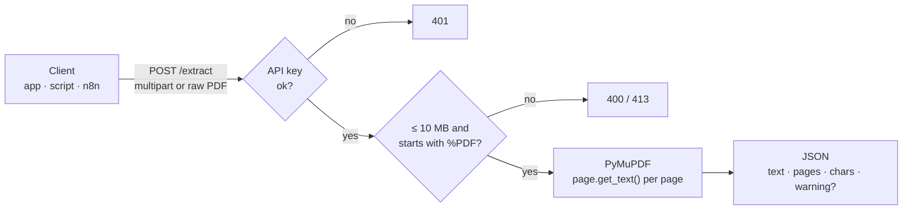

<div align="center">

# 📄 PDF Parser Service

### Send a PDF, get its text back as JSON. One endpoint, about 100 lines of Python.

A tiny FastAPI microservice that pulls text out of PDFs with **PyMuPDF**.<br>
Built to live comfortably on **Render's free tier** (512 MB RAM) and be called from any app, script or n8n workflow.

[](https://www.python.org/)
[](https://fastapi.tiangolo.com)
[](https://pymupdf.readthedocs.io)
[](#%EF%B8%8F-deploy-on-render)
[](#-contributing)
[](https://github.com/Pranav-Conova/PDF-parser-service/stargazers)

[**Quick start**](#-quick-start) · [**API**](#-api) · [**How it works**](#%EF%B8%8F-how-it-works) · [**Configuration**](#%EF%B8%8F-configuration) · [**Deploy**](#%EF%B8%8F-deploy-on-render)

<br>

[](https://render.com/deploy?repo=https://github.com/Pranav-Conova/PDF-parser-service)

</div>

---

## 🤔 Why?

Plenty of tools need "the text inside this PDF": an LLM pipeline, a résumé parser, a search index, an automation workflow. Most of them run somewhere that can't easily install PDF libraries, like a serverless function, a browser, or a no-code tool.

**PDF Parser Service gives them one HTTP endpoint instead.**

- ⚡ **Fast**: PyMuPDF (MuPDF under the hood) extracts text in milliseconds for typical documents.
- 🪶 **Small**: one file, five dependencies, fits in a free 512 MB instance.
- 🔌 **Easy to call**: accepts a normal multipart upload *or* the raw PDF bytes as the request body.
- 🔒 **Optional API key**: set `API_KEY` and every request must send it in `x-api-key`.
- 🧭 **Honest output**: scanned, image-only PDFs come back with a clear warning instead of an empty string you have to puzzle over.

## ⚡ Quick start

```bash
git clone https://github.com/Pranav-Conova/PDF-parser-service.git
cd PDF-parser-service

python -m venv venv
source venv/bin/activate        # Windows: venv\Scripts\activate
pip install -r requirements.txt

uvicorn main:app --reload
```

The API runs at **http://localhost:8000**, with interactive docs at **http://localhost:8000/docs**.

```bash
curl -F "file=@document.pdf" http://localhost:8000/extract
```

## 📡 API

| Method | Path | What it does |
|---|---|---|
| `POST` | `/extract` | Extract text from a PDF (multipart **or** raw body) |
| `GET` | `/health` | Health check: `{"status": "ok"}` |
| `GET` | `/` | Service name, version and endpoint list |
| `GET` | `/docs` | Swagger UI (FastAPI) |

### Multipart upload

```bash
curl -X POST https://your-pdf-service.onrender.com/extract \
  -H "x-api-key: YOUR_KEY" \
  -F "file=@document.pdf"
```

### Raw binary body

```bash
curl -X POST https://your-pdf-service.onrender.com/extract \
  -H "x-api-key: YOUR_KEY" \
  -H "Content-Type: application/pdf" \
  --data-binary @document.pdf
```

### From code

<details open>
<summary><b>Python</b></summary>

```python
import requests

with open("document.pdf", "rb") as f:
    r = requests.post(
        "https://your-pdf-service.onrender.com/extract",
        headers={"x-api-key": "YOUR_KEY"},
        files={"file": f},
    )
print(r.json()["text"])
```

</details>

<details>
<summary><b>JavaScript (browser or Node 18+)</b></summary>

```js
const form = new FormData();
form.append("file", fileInput.files[0]);

const res = await fetch("https://your-pdf-service.onrender.com/extract", {
  method: "POST",
  headers: { "x-api-key": "YOUR_KEY" },
  body: form,
});
const { text, pages } = await res.json();
```

</details>

### Response

```json
{
  "text": "Page 1 content here\nPage 2 content here",
  "pages": 2,
  "chars": 39
}
```

Pages are joined with a newline. If the PDF only contains scanned images:

```json
{
  "text": "",
  "pages": 1,
  "chars": 0,
  "warning": "No extractable text found; PDF may be image-based and require OCR."
}
```

### Errors

| Status | When |
|---|---|
| `400` | Empty request, no file, or the bytes don't start with `%PDF` |
| `401` | `API_KEY` is set and `x-api-key` is missing or wrong |
| `413` | File is larger than **10 MB** |
| `422` | The file looks like a PDF but can't be opened (corrupt) |
| `500` | Anything unexpected; the body names the exception type only |

## ⚙️ How it works



1. The request is checked for the API key (if one is configured).
2. The PDF comes either from the `file` form field or the raw body.
3. Size (10 MB max) and the `%PDF` magic bytes are checked before parsing.
4. PyMuPDF opens the document **in memory** (nothing is written to disk), extracts each page's text, and closes it.
5. If the result is blank, a warning suggests the PDF needs OCR.

CORS is open to all origins, so browsers can call the service directly.

## ⚙️ Configuration

| Variable | Default | Purpose |
|---|---|---|
| `API_KEY` | *(unset)* | When set, requests must send a matching `x-api-key` header. When unset, the API is open. |
| `PORT` | `8000` locally | Set automatically by Render |

Locally, `API_KEY` can go in a `.env` file.

## ☁️ Deploy on Render

The repo includes a [Render Blueprint](render.yaml).

1. Click **Deploy to Render** above, or choose **New → Blueprint** in Render and connect this repo.
2. Set `API_KEY` in the Render dashboard if you want to require a key (recommended for a public URL).
3. Render builds it and uses `/health` as the health check.

> The free tier sleeps after ~15 minutes idle, so the first request after a pause takes a few seconds.

## 🗂 Project structure

```text
PDF-parser-service/
├── main.py           the whole service: validation, extraction, routes
├── requirements.txt  fastapi, uvicorn, pymupdf, python-multipart, python-dotenv
└── render.yaml       Render Blueprint
```

## 🗺️ Ideas

- [ ] OCR fallback for scanned PDFs (Tesseract)
- [ ] Per-page output and page ranges
- [ ] Extract tables and images, not just text

## 🤝 Contributing

Issues and pull requests are welcome. Keep it small: the point of this service is that it fits on a free instance.

## 🧰 Built with

[FastAPI](https://fastapi.tiangolo.com), [PyMuPDF](https://pymupdf.readthedocs.io), [Uvicorn](https://www.uvicorn.org)

---

<div align="center">

If this saved you from wrestling with PDF libraries, a ⭐ helps other people find it.

</div>
